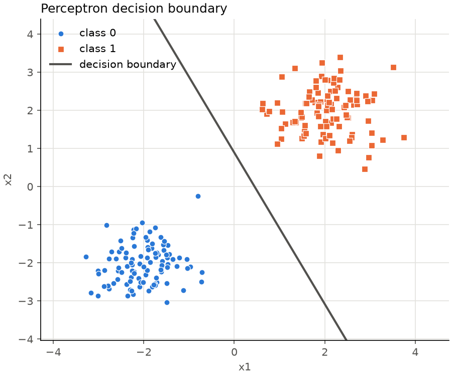
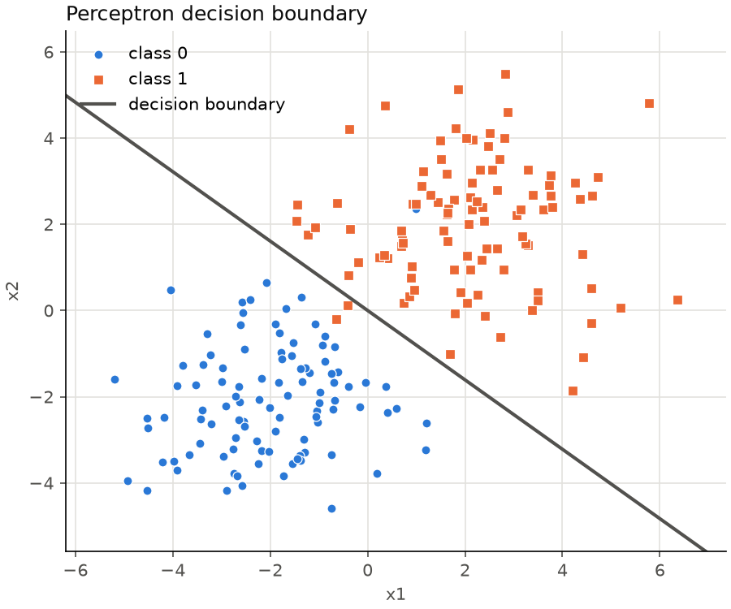
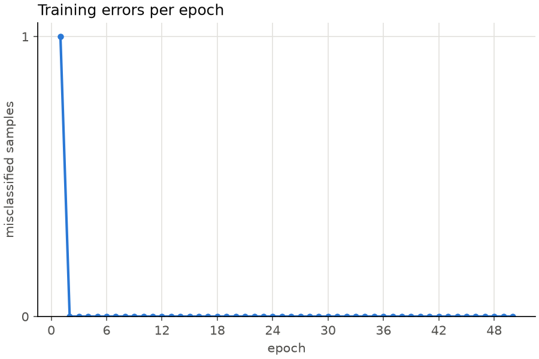
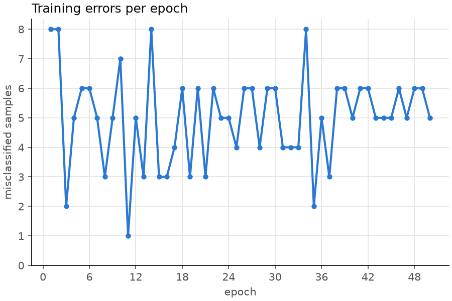

# Perceptron


Однослойный перцептрон для бинарной классификации, реализованный с нуля на Python и NumPy.
Лабораторная работа 1, трек Data Science, тема А1.

Программа генерирует два облака точек на плоскости, обучает перцептрон их разделять,
печатает точность и строит графики. Дополнительно модель проверяется на реальном
датасете iris.

## Как работает перцептрон

1. Взвешенная сумма признаков: `z = w · x + b`.
2. Пороговая активация: класс `1`, если `z >= 0`, иначе `0`.
3. Обучение: для каждой точки `w += lr · (target − pred) · x`, `b += lr · (target − pred)`.
   Веса меняются только при ошибке.

Граница решения — прямая `w1·x1 + w2·x2 + b = 0`. Если классы линейно разделимы,
перцептрон гарантированно находит разделяющую прямую за конечное число шагов.

## Установка

Нужен [uv](https://docs.astral.sh/uv/) и Python 3.13+ (uv скачает его сам).

```bash
git clone https://github.com/lamoirex/perceptron.git
cd perceptron
uv sync
```

## Запуск

```bash
uv run python perceptron.py --samples 200 --lr 0.1 --epochs 50
```

```
Dataset: two clusters, 200 samples
Learning rate: 0.1, epochs: 50
Converged at epoch 2
Weights: [0.223, 0.112], bias: -0.100
Accuracy: 100.00%
```

### Аргументы

| Аргумент | По умолчанию | Описание |
|---|---|---|
| `--dataset` | `clusters` | `clusters`, `iris-setosa` или `iris-versicolor` |
| `--samples` | `200` | число точек (только `clusters`) |
| `--lr` | `0.1` | скорость обучения |
| `--epochs` | `50` | число эпох |
| `--spread` | `0.6` | разброс облаков (только `clusters`) |
| `--plot-dir` | — | папка для сохранения графиков PNG |
| `--seed` | — | зерно генератора для воспроизводимости |

Справка: `uv run python perceptron.py --help`.

### Примеры

```bash
# графики границы решения и ошибок по эпохам
uv run python perceptron.py --seed 42 --plot-dir plots

# облака перекрываются — данные не разделимы, ошибка не доходит до нуля
uv run python perceptron.py --seed 42 --spread 1.5 --plot-dir plots

# реальные данные: iris
uv run python perceptron.py --dataset iris-setosa --seed 42
uv run python perceptron.py --dataset iris-versicolor --seed 42 --epochs 100
```

## Графики

| Разделимые данные (`--seed 42`) | Перекрывающиеся данные (`--spread 1.5`) |
|---|---|
|  |  |
|  |  |

Слева перцептрон сошёлся за 2 эпохи и разделил классы без ошибок. Справа облака
перекрываются: число ошибок колеблется и не падает до нуля, точность 98.5%.

## Проверка на iris

Данные делятся на обучающую (70%) и тестовую (30%) выборки. Признаки масштабируются
по статистикам обучающей выборки.

| Задача | Классы | Train | Test |
|---|---|---|---|
| `iris-setosa` | setosa против остальных | 100% | 100% |
| `iris-versicolor` | versicolor против virginica | 100% | 86.67% |

Setosa линейно отделима от других видов. Versicolor и virginica частично перекрываются,
поэтому на новых данных перцептрон ошибается. Это ограничение линейной модели.

## Тесты и проверки

```bash
uv run pytest               # 40 тестов
uv run ruff check .         # линтер
uv run ruff format --check . # форматирование
uv run mypy .               # проверка типов (strict)
```

Все проверки запускаются в GitHub Actions на каждый push (`.github/workflows/ci.yml`).

## Структура

```
neuron/
├── model.py   # класс Perceptron: activate, predict, train, score
├── data.py    # синтетические данные, iris, разбиение train/test, масштабирование
├── plots.py   # граница решения и график ошибок
└── cli.py     # аргументы командной строки и запуск
tests/         # pytest
perceptron.py  # точка входа
```
